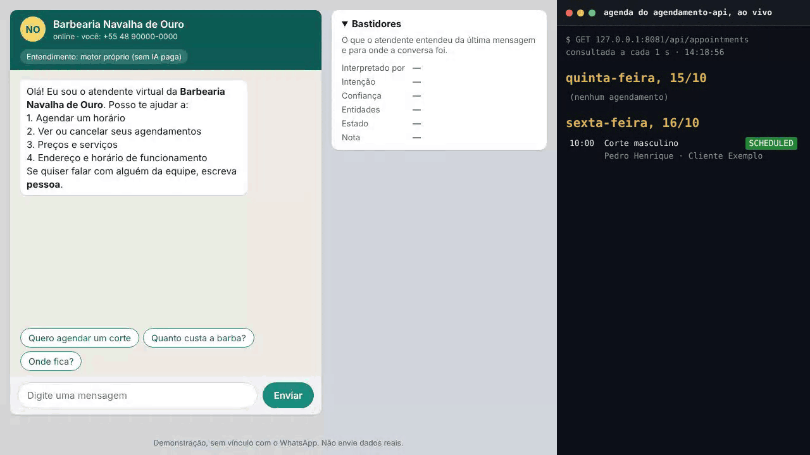
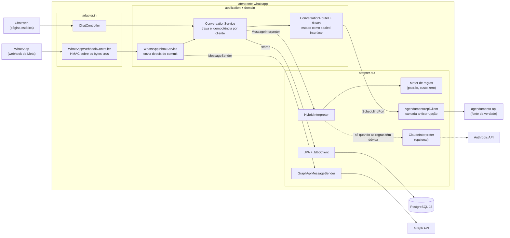
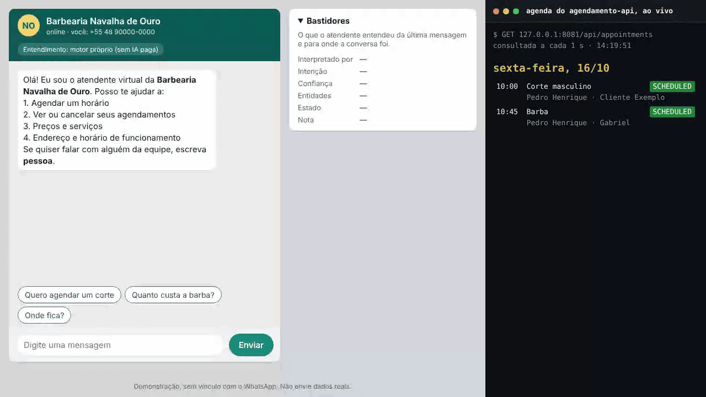

# atendente-whatsapp


Um núcleo de conversa, dois canais (chat web e WhatsApp Cloud API), dois cérebros plugáveis (regras ou Claude) e uma
API de agendamento real, com testes que não chamam nenhum serviço pago.

O atendente marca, lista e cancela horários de uma barbearia fictícia conversando em português de chat, com erro de
digitação e abreviação, e grava tudo no [agendamento-api](https://github.com/Gabriel-Pacheco-K/agendamento-api), outro
projeto meu, que é a fonte da verdade da agenda.



*Gravado com o atendente, o agendamento-api e o PostgreSQL rodando de verdade, só com o motor de regras. A digitação
foi automatizada com Playwright; as respostas são as do atendente. O painel da direita é uma página local que o
script de gravação alimenta consultando `GET /api/appointments` do agendamento-api a cada segundo: são as mesmas
linhas que o [`scripts/agenda-ao-vivo.sh`](scripts/agenda-ao-vivo.sh) mostra num terminal. Como a demo foi feita está
em [Demo](#demo).*

---

## O problema

O dono de um pequeno negócio responde o WhatsApp o dia inteiro, e a maior parte das mensagens é a mesma: "tem horário
amanhã?", "quanto é a barba?", "preciso desmarcar". Um robô para isso precisa entender "qro marca amanha de tarde c/ o
joao" sem pagar por IA a cada mensagem, nunca marcar duas vezes o mesmo horário quando o cliente manda "sim" três
vezes, e nunca dizer "agendado" sem que a agenda tenha mesmo o horário.

## O que ele faz

1. **Agenda preenchendo lacunas.** Pergunta só o que falta (serviço, profissional, dia, horário, nome). Uma frase
   completa agenda em três mensagens: a frase, o nome e o "sim".
2. **Sugere quando não dá.** Horário ocupado vira os livres mais próximos; dia fechado, lotado ou feriado vira o
   próximo dia com vaga. Nunca oferece dia além de 30 dias nem horário fora do expediente.
3. **Lista e cancela** os agendamentos do próprio cliente, com confirmação.
4. **Responde preços, endereço, horário e perguntas frequentes**, também no meio de um agendamento, sem perder o
   andamento.
5. **Passa para uma pessoa** quando o cliente pede ou depois de duas mensagens seguidas que ele não entendeu.
6. **Dois canais, um núcleo:** uma página que imita o WhatsApp, com o painel "Bastidores" mostrando o que foi entendido,
   e o webhook da WhatsApp Cloud API, com assinatura HMAC, idempotência e envio pela Graph API.

## Arquitetura

Ports and adapters de verdade: o domínio é Java puro, a aplicação conversa só com portas, e o
[`ArchitectureTest`](src/test/java/com/gabrielpacheco/atendente/ArchitectureTest.java) quebra o build se alguém furar
uma camada, se o SDK da Anthropic sair do adaptador dele ou se alguém ler o relógio sem `Clock`.



| Pacote | O que tem |
|---|---|
| `domain` | Normalização de texto, distância de edição, catálogo, rascunho do agendamento, os 9 estados da conversa, textos e formatação em PT-BR. Só depende de `java.*`. |
| `application` | `ConversationService` (o turno inteiro numa transação), o roteador e os fluxos de agendamento, cancelamento e informação, e as portas. |
| `adapter.in` | Chat web (`/api/chat`), webhook do WhatsApp, filtros de cabeçalhos, tamanho de corpo e limite de taxa. |
| `adapter.out` | Motor de regras, Claude, cliente do agendamento-api, persistência e envio pela Graph API. |
| `config` | Propriedades, montagem dos beans e falha rápida na subida quando falta configuração. |

## Como ele entende português sem IA paga

O [`RuleBasedInterpreter`](src/main/java/com/gabrielpacheco/atendente/adapter/out/nlu/rules/RuleBasedInterpreter.java)
é Java puro e determinístico, sem dependência e sem rede. São cinco etapas, e cada extrator consome o trecho que
reconheceu, para "15h" não virar "dia 15" logo depois. Com hoje sendo terça, 13/10/2026:

| Etapa | Resultado |
|---|---|
| Entrada | `Oiii, qro agnedar um corte p/ amanhã ás 3 da tarde c/ o Joao!!` |
| Normalizado | `oi quero agnedar um corte para amanha as 3 da tarde com o joao` (minúsculas, sem acento, "oiii" vira "oi", "qro" vira "quero", "p/" e "c/" viram "para" e "com") |
| Corrigido | `oi quero agendar um corte para amanha as 3 da tarde com o joao` ("agnedar" está a 1 transposição de "agendar") |
| Entidades | hora 15:00 · data 2026-10-14 · João Batista · Corte masculino |
| Pontuação | BOOK = 3 (agendar) + 2 (bônus por ter entidades de agenda) = 5, contra GREETING = 2 (oi) |
| Saída | BOOK com confiança 0,90: folga de 3 pontos sobre a segunda colocada dá 1,0, e ×0,9 porque a pista veio de uma palavra corrigida |

Algumas regras que valem a pena saber:

- A correção usa a distância OSA (Levenshtein com transposição), escrita à mão, com tolerância por tamanho da palavra
  (até 3 letras nada é corrigido) e a primeira letra obrigatória, para "porte" não virar "corte".
- "às 4" é 16:00, "segunda" sozinha é dia da semana, e com várias datas na frase vale a última. O resumo sempre mostra
  dia da semana, data e hora antes do "sim", então uma regra fixa errada aparece antes de virar agendamento.
- Na hora de pedir o nome, nada é corrigido: "Clara" não pode virar "claro".
- O corpus [`frases.csv`](src/test/resources/nlu/frases.csv) tem 123 frases com a intenção e as entidades esperadas, e o
  `IntentCorpusTest` exige 100%. Todo bug de entendimento vira uma linha nova.

## Decisões técnicas

**Estado da conversa como `sealed interface` com 9 records.** Cada estado carrega só o que faz sentido nele (o resumo
tem o horário escolhido, a lista de cancelamento tem os índices), as invariantes ficam nos construtores compactos e os
`switch` são exaustivos sem `default`. Um estado novo que alguém esqueça de tratar não compila. O estado vai para o
banco como JSONB, com os mixins do Jackson no adaptador de persistência, sem anotação no domínio.

**Quem interpreta não decide.** O interpretador, regras ou Claude, só devolve intenção, confiança e entidades. Quem
decide o próximo passo é a máquina de estados, e agendar ou cancelar exige um "sim" determinístico em cima de um resumo
que o próprio atendente montou. Nenhum id vem do texto do cliente nem do modelo.

**Claude opcional, e só quando agrega.** Sem `ANTHROPIC_API_KEY`, nenhum bean do SDK é criado e o custo por mensagem é
zero. Com a chave, o `HybridInterpreter` roda as regras primeiro e só chama o Claude quando a confiança delas fica
abaixo de 0,75. Ele nunca é chamado na confirmação (o "sim" que agenda) nem quando o cliente diz o nome, que ficam
sempre com as regras, nem para textos com menos de 3 letras. Se o Claude falhar ou recusar, vale o que as regras
entenderam, e os bastidores mostram "Claude indisponível". Por que opcional: as frases comuns de agendamento as regras
já resolvem; o resto é cauda longa, e não faz sentido pagar e mandar dado de cliente para fora em toda mensagem.

**Por que o padrão é o `claude-haiku-5-5`.** A tarefa é classificar intenção e extrair entidades num esquema fechado,
o nicho do modelo rápido e barato. Ele custa US$ 0,10 por milhão de tokens de entrada e US$ 0,50 de saída, 40 vezes
menos que o Opus 5.5 (US$ 4 / US$ 20). As contas, com o catálogo de exemplo:

| | Tokens | Custo |
|---|---|---|
| Entrada: instruções, catálogo, esquema JSON e a mensagem (cerca de 3 mil caracteres) | ~1.000 a 1.500 | US$ 0,0001 a 0,00015 |
| Saída típica: o JSON mais o raciocínio adaptativo, curto no effort low | ~200 a 500 | US$ 0,0001 a 0,00025 |
| **Típico por mensagem com dúvida** | | **abaixo de US$ 0,001** (perto de US$ 0,0003) |
| Pior caso: os 2.048 tokens de `max-tokens` inteiros na saída | 2.048 | US$ 0,00102 + entrada = **~US$ 0,0012** |

Mil mensagens com dúvida por mês custam perto de US$ 0,30, e US$ 1,20 no pior caso. O raciocínio adaptativo fica
ligado por padrão no Haiku 5.5 e conta como saída, por isso o pior caso considera o teto inteiro. O gateway registra no
log só a contagem de tokens de entrada e de saída de cada chamada, para conferir o custo real. O modelo muda com
`CLAUDE_MODEL`.

**Effort low combinado com saída estruturada.** No SDK `anthropic-java` 2.34.0, `outputConfig(ClaudeExtraction.class)`
gera o esquema JSON a partir do record (todos os campos obrigatórios, `additionalProperties: false`) e tipa a resposta,
mas não deixa escolher o effort, e chamá-lo duas vezes lança `IllegalArgumentException`. O
[`AnthropicClaudeGateway`](src/main/java/com/gabrielpacheco/atendente/adapter/out/nlu/claude/AnthropicClaudeGateway.java)
gera esse `OutputConfig` uma vez, no construtor, acrescenta o effort lido de `CLAUDE_EFFORT` e chama
`outputConfig(Class)` seguido de `outputConfig(OutputConfig)`. O corpo sai com
`"output_config":{"effort":"low","format":{"type":"json_schema",...}}`, e o `AnthropicClaudeGatewayTest` confere isso
com o SDK de verdade contra o WireMock. Dois detalhes do Haiku 5.5 que o código respeita: `temperature` fora do padrão
e prefill dão 400, então nenhum dos dois é enviado; e uma recusa chega com `stop_reason: refusal` sem fallback do lado
do servidor para esse modelo, então ela cai de propósito para o motor de regras. Um `Optional<Enum>` quebra a validação
local do esquema no SDK, por isso o período do dia usa o valor sentinela `NONE`.

**O agendamento-api é a fonte da verdade.** A disponibilidade vem dele, e o motivo de um 422 é repassado ao cliente
como veio, sem duplicar no atendente a regra de cancelamento até 2 h antes ou a de 60 dias. O atendente guarda só o
que a API não sabe ou não aplica na disponibilidade: os feriados do `business.yml` (que nunca são oferecidos) e o
limite de 30 dias na busca, porque a disponibilidade da API não aplica os 60 dias e o cliente descobriria isso só no
"sim". A antecedência mínima de 30 minutos é espelhada só para explicar por que um horário não serve; quem decide
continua sendo a API.

**O POST nunca é repetido, e a reconciliação é estreita.** Só os GETs têm uma retentativa. Se o POST de agendamento
dá timeout ou 502, o resultado é desconhecido: o atendente olha a agenda do dia duas vezes, com uma pausa, procurando um
agendamento ativo no mesmo horário com o mesmo telefone e o mesmo nome, e descarta qualquer candidato que já pertença a
outro cliente (o telefone da web é digitado; sem esse filtro, dava para tomar posse do horário alheio). Se não achar,
guarda a tentativa (`pendingAttempt`): um 409 no próximo "sim" para o mesmo horário é reconhecido como dele, e se o
cliente mudar de assunto ou a conversa expirar, a agenda é conferida de novo antes de seguir.

**Trava pessimista por cliente.** O turno inteiro roda numa transação que lê a conversa com `SELECT ... FOR UPDATE`.
Com `lock_timeout` de 3 s, quem não consegue a trava recebe 503 "Atendente ocupado" com `Retry-After: 1`, e a página
repete o pedido com o mesmo `clientMessageId`.

**Idempotência por cliente nos dois canais.** `processed_messages` tem a chave `(customer_id, message_id)`: na web o id
é o `clientMessageId` gerado pela página, no WhatsApp é o `wamid`. A verificação acontece já sob a trava, então uma
cópia concorrente espera a original terminar e encontra o registro. Na web a resposta fica guardada por 24 h, e o
reenvio devolve o mesmo corpo com `X-Idempotent-Replay: true`. A chave inclui o cliente, então reaproveitar o id de
outra sessão não devolve a resposta dela.

**Camada anticorrupção para o agendamento-api.** Os DTOs do fio (`AgendamentoApiJson`) nunca saem do pacote, e o
`ProblemDetailMapper` traduz cada erro por operação (agendar, cancelar, consultar) para as exceções da porta. Ele tolera
o JSON padrão do Spring Boot nos 500 (que não vêm em ProblemDetail) e registra um WARN de contrato quando a API responde
algo que ele não conhece.

**`Clock` injetado em tudo.** Nada chama `now()` sem `Clock`, e o ArchUnit garante. Os testes usam um relógio mutável
para avançar 31 minutos e provar que um "sim" atrasado não agenda nada, sem `sleep`.

**PtBr feito à mão.** Datas, dias da semana e dinheiro são formatados sem os dados de locale da JVM (o CLDR usa espaço
não separável em "R$ 45,00", e o resultado mudaria conforme a imagem). O `TextsSnapshotTest` congela os textos que o
cliente lê.

**JPA e JdbcClient, cada um onde é melhor.** JPA para as entidades e a trava; `JdbcClient` com parâmetros nomeados
para o upsert com `ON CONFLICT`, a idempotência com JSONB e a retenção.

## Concorrência e idempotência

O cliente aperta "Sim" e, impaciente, manda "sim" de novo, ou a rede repete o pedido. O
[`ConversationConcurrencyIntegrationTest`](src/test/java/com/gabrielpacheco/atendente/application/ConversationConcurrencyIntegrationTest.java)
deixa a conversa no resumo, faz o POST demorar 300 ms no WireMock e solta oito "sim" ao mesmo tempo (um
`CountDownLatch` de largada, oito threads, PostgreSQL 16 real no Testcontainers). O resultado tem que ser exatamente
**1 POST** no agendamento-api, **1 "Agendado"** e **7 "já está confirmado"**.

**Contraprova** (feita à mão, não fica no build). Sem a trava, os oito "sim" passam do resumo juntos e os oito chegam
ao POST; o WireMock devolve o mesmo id aos oito, sete turnos estouram na chave única de `bookings` e o teste quebra. Ela
mostrou também um detalhe: tirar só o `FOR UPDATE` não basta, porque o `UPDATE customers SET last_seen_at` do começo
do turno também prende a linha do cliente até o commit. O teste só falha com as duas desligadas. O `FOR UPDATE` é a
trava declarada e continua valendo se o upsert do cliente mudar.

Os outros testes que fecham essa história:

| Situação | Prova |
|---|---|
| Mesmo `clientMessageId` repetido na web: corpo idêntico e 1 POST só | `ChatApiIntegrationTest` |
| Cinco POSTs paralelos do mesmo `wamid` no webhook: 1 resposta enviada | `WhatsAppWebhookIntegrationTest` |
| "Sim" 31 minutos depois do resumo: recomeça com segurança, 0 POST | `GlobalRulesDialogTest` |
| Timeout no POST, agendamento encontrado na conferência | `BookingFailuresDialogTest` |
| Outra sessão com o telefone e o nome de outro cliente não ganha a posse do horário | `CustomerIsolationIntegrationTest` |
| Duas sessões confirmam o mesmo horário no agendamento-api real: uma agenda, a outra ouve "alguém acabou de reservar" | `scripts/smoke-test.sh` no CI |

O 409 também foi gravado: outro cliente reserva o horário direto no agendamento-api enquanto o resumo está na tela, e o
"sim" recebe os horários mais próximos em vez de um agendamento duplicado.



## Ameaças e defesas

| # | Ameaça | Defesa | Prova |
|---|---|---|---|
| 1 | Webhook forjado | HMAC-SHA256 sobre os bytes crus, antes de qualquer parse; comparação em tempo constante; 401 sem detalhes | `WebhookSignatureVerifierTest` (vetores do openssl, inclusive "á" escapado), `WhatsAppWebhookIntegrationTest` |
| 2 | Replay ou reenvio da Meta | Idempotência por cliente e `wamid` por 14 dias; mensagem com mais de 24 h é ignorada | `WhatsAppWebhookIntegrationTest` |
| 3 | Webhook ligado sem segredo | A aplicação não sobe e cita o nome das variáveis que faltam; desligado, as rotas nem existem | `ConfigurationWiringTest` |
| 4 | Verify token adivinhado ou challenge refletido | Comparação em tempo constante; token de 32 caracteres ou mais; challenge só se casar `^[A-Za-z0-9_-]{1,64}$` | `WhatsAppWebhookIntegrationTest` (`<script>` dá 403) |
| 5 | Mensagem para outro número da conta | `phone_number_id` conferido | `WhatsAppMessageExtractorTest` |
| 6 | Passar-se por outro cliente na web | A identidade é o UUID que o servidor emite, não o telefone; canais separados | `CustomerIsolationIntegrationTest` |
| 7 | IDOR no cancelamento | O id nunca vem do texto, só índices da própria lista; posse conferida de novo antes do PATCH | `CancellationDialogTest`, `CustomerIsolationIntegrationTest` |
| 8 | IDOR pela reconciliação | Candidato de outro cliente é descartado; o 409 só reconcilia com a tentativa guardada do mesmo profissional e horário | `BookingFailuresDialogTest`, `CustomerIsolationIntegrationTest` |
| 9 | Ler a resposta de outra sessão reaproveitando o `clientMessageId` | Idempotência com o cliente na chave | `ChatApiIntegrationTest` |
| 10 | "Sim" atrasado ou duplicado marcando de novo | Conversa expirada não executa "sim" nem número; o último agendamento responde "já está confirmado"; trava por cliente | `GlobalRulesDialogTest`, `ConversationConcurrencyIntegrationTest` |
| 11 | Prompt injection, com o Claude ligado | O modelo só classifica num esquema fechado; nenhum id vem dele; texto do cliente delimitado e com `<` e `>` neutralizados; ações exigem o "sim" das regras | `ClaudeInterpreterTest`, `HybridInterpreterTest` |
| 12 | Ataque de custo | Claude desligado por padrão; só com dúvida; limites de taxa; 500 caracteres; `max-tokens` 2048; effort low; timeout de 6 s sem retentativa | `HybridInterpreterTest` |
| 13 | XSS no chat | Texto do servidor entra no DOM só por `textContent`; CSP sem `unsafe-inline` | `SecurityHeadersIntegrationTest`, que também lê os arquivos estáticos |
| 14 | Clickjacking, MIME sniffing, vazamento de referer | CSP com `frame-ancestors 'none'`, `X-Frame-Options`, `nosniff`, `Referrer-Policy: no-referrer`, `Cache-Control: no-store` na API | `SecurityHeadersIntegrationTest` |
| 15 | Corpo grande, JSON profundo, flood | 256 KB no webhook e 16 KB na API, inclusive com envio em partes; profundidade 20 e strings de 8 KB no parser do webhook; até 50 mensagens por payload; limites por IP, sessão e `wa_id`; `lock_timeout` e `statement_timeout` | `WhatsAppWebhookIntegrationTest`, `ChatApiIntegrationTest`, `RateLimiterTest` |
| 16 | Vazamento de segredos | Só variáveis de ambiente; `.env` no `.gitignore` e no `.dockerignore`; `toString` das propriedades mascarado; actuator só com `health` | `PropertiesToStringMasksSecretsTest` |
| 17 | Dados pessoais em log | Texto da mensagem e nome nunca vão para o log; telefone mascarado; `wa_id` nunca | `NoPersonalDataInLogsIntegrationTest` |
| 18 | Detalhe interno em erro | `server.error.include-*` desligados; 500 genérico em ProblemDetail | `ChatApiIntegrationTest` |
| 19 | SQL injection | JPA e `JdbcClient` com parâmetros nomeados | revisão |
| 20 | SSRF | URLs só de configuração; redirecionamentos desligados nos clientes HTTP | revisão |
| 21 | agendamento-api (sem autenticação) exposto | Rede interna do compose; porta publicada só em 127.0.0.1 | `docker-compose.yml` |
| 22 | Contêiner | UID 10001, `read_only`, `tmpfs` em `/tmp`, `cap_drop: ALL`, `no-new-privileges` | `Dockerfile`, `docker-compose.yml` |
| 23 | Cadeia de suprimentos | Dependabot semanal, versões fixas, CI com `permissions: contents: read` | `.github/` |

## Privacidade (LGPD)

**O que fica guardado.** O texto das mensagens dos clientes nunca é gravado. O banco do atendente tem:

- `customers`: canal, id externo (o UUID da sessão na web, o `wa_id` no WhatsApp), telefone, nome quando informado e
  as datas de criação e do último contato;
- `conversations`: o estado da conversa em JSON (o rascunho do agendamento em andamento);
- `bookings`: os agendamentos que o atendente criou (o agendamento-api não busca por telefone), com serviço,
  profissional, preço, horário e status;
- `processed_messages`: o id de cada mensagem já processada e, só na web, a resposta, para o reenvio idempotente.

**Por quanto tempo.** Um job diário, às 03:30 no fuso da barbearia, apaga a idempotência depois de 14 dias, descarta as
respostas guardadas da web depois de 24 h, apaga os clientes da web (com conversa e agendamentos locais) depois de 7
dias e os do WhatsApp sem contato há 180 dias e sem agendamento futuro ativo. Tudo configurável em `app.retention`.

**Nos logs.** Uma linha por turno, sem texto, nome nem telefone:

```
turno canal=WEB cliente=1 estado=IDLE->ASKING_NAME intencao=BOOK origem=RULES confianca=0.90 total_ms=142
```

Quando um telefone precisa aparecer, ele sai mascarado (`+55 48 9****-0000`). O `NoPersonalDataInLogsIntegrationTest`
captura os logs de uma conversa inteira nos dois canais e falha se aparecer nome, telefone, `wa_id`, texto da mensagem
ou o app secret.

**No agendamento-api.** Nome e telefone vão no agendamento, porque são o que a barbearia precisa para atender.

**Com o Claude ligado.** O texto da mensagem com dúvida vai para a Anthropic: no máximo 500 caracteres, com telefones
trocados por `[número]` e entre marcadores que o cliente não consegue fechar. Não vão o telefone do cliente, o histórico
da conversa nem outros clientes, e o passo em que o cliente diz o nome nunca chama o Claude. Quem ligar a chave precisa
informar isso aos clientes na política de privacidade.

**Política da Meta.** O WhatsApp Business restringe chatbots de IA de uso geral. Aqui o Claude, quando ligado, só
classifica intenção e entidades de um atendimento de barbearia; ele não conversa livremente nem escreve as respostas,
que são sempre os textos do próprio atendente.

## Como executar

Precisa de Docker com Compose. O compose sobe o PostgreSQL, o agendamento-api (construído do GitHub, fixado num
commit), um seed com os profissionais e serviços da barbearia e o atendente:

```bash
cp .env.example .env    # opcional: só para o Claude ou o WhatsApp
docker compose up --build
```

Abra http://localhost:8080. O selo no topo da conversa diz qual motor está entendendo as mensagens. O agendamento-api
fica em http://127.0.0.1:8081 (a agenda de um dia é `/api/appointments?professionalId=1&date=AAAA-MM-DD`), e o
`scripts/agenda-ao-vivo.sh` mostra num terminal, atualizada a cada segundo, a agenda de amanhã e da próxima sexta
(precisa de `curl`, `jq` e `watch`). Para recomeçar do zero: `docker compose down -v`.

**Desenvolvimento.** Suba só as dependências e rode o atendente pelo Maven:

```yaml
# docker-compose.override.yml (já está no .gitignore). O db só existe na rede interna, que não publica porta:
# por isso ele entra também na rede edge.
services:
  db:
    ports: ["127.0.0.1:5432:5432"]
    networks: [backend, edge]
```

```bash
docker compose up -d db agendamento-api seed
mvn spring-boot:run
```

Os padrões do `application.yml` já apontam para `localhost:5432` e `localhost:8081`.

**Com o Claude.** Coloque a chave em `ANTHROPIC_API_KEY` no `.env` e suba de novo. `CLAUDE_MODEL` (padrão
`claude-haiku-5-5`) e `CLAUDE_EFFORT` (padrão `low`) são opcionais. Os testes nunca usam a chave: o surefire a remove
do ambiente.

**Dados do negócio.** Nome, endereço, horários, feriados, serviços e perguntas frequentes ficam no
[`business.yml`](src/main/resources/business.yml). Para trocar sem rebuild, veja [`config/README.md`](config/README.md).

### WhatsApp com o número de teste da Meta

1. Em developers.facebook.com, crie um app do tipo Business e adicione o produto WhatsApp. Anote o Phone Number ID. O
   token temporário vale 24 h; para mais tempo, use o token de um System User.
2. Cadastre o seu celular como destinatário. O número de teste só manda mensagem para poucos números verificados (fora
   deles, a Graph API devolve o erro 131030, que vai para o log).
3. Abra um túnel até o atendente: `cloudflared tunnel --url http://localhost:8080`.
4. Em Webhooks, use a URL `https://<seu-túnel>/webhook/whatsapp`, o seu `WHATSAPP_VERIFY_TOKEN` (gere com
   `openssl rand -hex 32`) e assine o campo `messages`.
5. No `.env`: `WHATSAPP_ENABLED=true`, `WHATSAPP_VERIFY_TOKEN`, `WHATSAPP_APP_SECRET` (App Settings > Basic),
   `WHATSAPP_PHONE_NUMBER_ID`, `WHATSAPP_SENDING_ENABLED=true` e `WHATSAPP_ACCESS_TOKEN`. Atrás do túnel, use
   `FORWARD_HEADERS=native`, para o limite por IP ver o IP de verdade. Depois, `docker compose up`.
6. Confira no painel a versão vigente da Graph API e ajuste `WHATSAPP_GRAPH_VERSION` (padrão `v23.0`).

Com o webhook ligado e o envio desligado, as respostas só aparecem no log, mascaradas. O
[`scripts/simular-webhook.sh`](scripts/simular-webhook.sh) manda uma mensagem assinada como a Meta mandaria, para
testar sem celular.

### Demo

O GIF do topo sai de [`docs/demo/gravar-demo.mjs`](docs/demo/gravar-demo.mjs), que usa Playwright 1.56.1 com
`package.json` próprio, fora do build Maven:

```bash
docker compose down -v && docker compose up --build -d
docs/demo/preparar-demo.sh          # ocupa a próxima sexta às 10:00 com o Pedro, para a cena do horário ocupado
cd docs/demo && npm install && npx playwright install chromium
node gravar-demo.mjs                # docs/demo.gif
node gravar-demo.mjs --cena-conflito  # docs/conflito.gif
```

O script grava com `recordVideo` duas páginas: o chat e a [agenda ao vivo](docs/demo/agenda-ao-vivo.html), que ele
alimenta consultando o agendamento-api a cada segundo. Ele digita com atraso de 55 ms por tecla, espera cada resposta
pela contagem de balões (nunca com pausa fixa) e confere o texto de cada resposta. No fim, confere pela API que o
agendamento de amanhã está CANCELLED e o de sexta está SCHEDULED, e sai com erro se não estiverem. Depois junta os dois vídeos lado a
lado com o ffmpeg (precisa estar no PATH) e gera o GIF com paleta própria, em até 6 MB. Grave na terça ou na quarta, para "amanhã" e "sexta"
serem dias abertos e diferentes; o script recusa outros dias e feriados sem `--forcar`. O `docs/requests.http` tem
exemplos de todas as rotas.

## Endpoints

| Método | Rota | O que faz |
|---|---|---|
| `GET` | `/` | A página do chat |
| `GET` | `/api/chat/business` | Nome, endereço, horário e o modo de interpretação (`RULES` ou `RULES_WITH_CLAUDE`) |
| `POST` | `/api/chat/sessions` | Abre uma sessão: `{"phone": "+55 48 90000-0000"}` → 201 com `sessionId`, boas-vindas e sugestões |
| `POST` | `/api/chat/sessions/{sessionId}/messages` | `{"clientMessageId": "<uuid>", "text": "..."}` → as respostas e, com `SHOW_DIAGNOSTICS=true`, os bastidores (`debug`) |
| `GET` | `/webhook/whatsapp` | Verificação do painel da Meta (só com `WHATSAPP_ENABLED=true`) |
| `POST` | `/webhook/whatsapp` | Eventos da Meta, com `X-Hub-Signature-256` |
| `GET` | `/actuator/health` | Saúde |

Os erros saem em ProblemDetail com título em português: 400 com `errors` por campo, 404 para sessão inexistente, 413
para corpo grande, 429 com `Retry-After` (20 mensagens por minuto por sessão, 60 pedidos por minuto e 10 sessões por
hora por IP), 503 "Atendente ocupado" com `Retry-After: 1` e 500 genérico. Exemplos prontos em
[`docs/requests.http`](docs/requests.http).

## Testes

```bash
mvn verify
```

São **978 testes**, todos verdes no último `mvn verify`, em cerca de um minuto. Nenhum chama serviço pago nem a
internet: o agendamento-api, a Graph API e a Anthropic são simulados pelo WireMock, e o banco é um PostgreSQL 16 de
verdade no Testcontainers.

| Grupo | O que cobre | Testes |
|---|---|---|
| Domínio | Normalização, distância de edição, datas e dinheiro em PT-BR, catálogo, sugestão de horários, invariantes dos estados, snapshot dos textos | 174 |
| Motor de regras | Correção de digitação, datas, horas, opções, nomes, classificação e o corpus de 123 frases | 367 |
| Diálogos | O núcleo da conversa inteiro, sem Spring, lido como diálogo (`Dialogo`), com uma agenda falsa que aplica as regras da real | 200 |
| Claude | O SDK de verdade contra o WireMock (corpo com effort low e `json_schema`, recusa, `max_tokens`, 500, 529, timeout), a validação contra o catálogo e as regras do híbrido | 45 |
| Clientes HTTP | Contrato do agendamento-api (erros por operação, POST nunca repetido, GET repetido uma vez) e envio pela Graph API | 34 |
| Entrada HTTP | Assinatura do webhook, extração das mensagens, limite de taxa, tamanho de corpo, IP do cliente | 36 |
| Persistência e configuração sem banco | Estado em JSON, eventos de transação, montagem dos beans e segredos mascarados | 40 |
| Arquitetura | As regras de camada do ArchUnit | 9 |
| Integração | Spring inteiro com PostgreSQL real: API do chat, webhook, isolamento entre clientes, concorrência, cabeçalhos, persistência, migrações, logs sem dados pessoais | 73 |

Alguns que valem abrir: `ConversationConcurrencyIntegrationTest` (os oito "sim"), `BookingFailuresDialogTest`
(timeout no POST, reconciliação e o caso em que ela não pode acontecer), `WhatsAppWebhookIntegrationTest` (cinco POSTs
paralelos do mesmo `wamid`, JSON profundo, mensagem envenenada), `AnthropicClaudeGatewayTest` e `IntentCorpusTest`.

No CI, o job `build` roda o `mvn verify` e o build da imagem Docker; o job `e2e` sobe o compose com o agendamento-api
real e roda o [`scripts/smoke-test.sh`](scripts/smoke-test.sh): agenda e cancela pelo chat conferindo o status na agenda
real, corre duas sessões pelo mesmo horário e testa o webhook com assinatura certa, repetida e errada. O JaCoCo gera o
relatório de cobertura como artefato, sem meta mínima de propósito; no último build, 96% das linhas e 87% dos ramos.

## Limitações conhecidas

- **O motor de regras tem limites.** Negação de longo alcance ("não sei se quero, mas talvez marcar"), ironia e duas
  intenções na mesma mensagem não são resolvidas. A defesa é o resumo antes do "sim", a pessoa da equipe na segunda
  mensagem não entendida e o Claude opcional para a cauda longa.
- **Resultado incerto do POST.** A reconciliação cobre o caso comum, mas sobram dois: o agendamento-api grava depois
  de todas as conferências (fica um agendamento na agenda que não aparece em "meus agendamentos"); e o POST dá certo,
  mas o commit local falha (sai um ERROR "criado no agendamento-api, mas a gravação local foi desfeita; conciliar
  manualmente", com o id). A solução definitiva depende do agendamento-api aceitar uma `Idempotency-Key`.
- **O webhook é síncrono.** O turno tem um orçamento de 12 s para as consultas à agenda (nenhuma começa sem caber nele)
  e até 6 s do Claude, quando ligado. Se a Meta reenviar no meio, a idempotência torna o reenvio seguro.
- **O envio pela Graph API não tem retentativa.** Uma falha no envio perde a resposta; o estado da conversa fica certo
  e o cliente pode mandar a mensagem de novo.
- **Estado em memória.** O limite de taxa e o cache do catálogo valem por instância.
- **Horário de funcionamento em dois lugares.** O `business.yml` e o expediente cadastrado no agendamento-api; o seed é
  coerente com o arquivo, e a carga do catálogo avisa quando não for.
- **Só texto.** Áudio, imagem e figurinha recebem um pedido educado para escrever. Remarcar é cancelar e agendar de
  novo.
- **Meta.** O token temporário vale 24 h, o número de teste aceita poucos destinatários e a versão da Graph API muda.

## Próximos passos

Cada item ficou de fora da v1 por um motivo:

- **Criar a tag `v1.0.0` no agendamento-api e trocar o SHA do compose por ela.** Hoje o compose está fixado no commit
  `b11f036`, que é exato mas não diz nada; uma tag documenta qual versão do contrato o atendente conhece.
- **`Idempotency-Key` no agendamento-api.** Fecha o caso do agendamento órfão, que hoje só se resolve com a
  reconciliação. Ficou de fora porque é mudança no outro projeto.
- **Tabela `booking_attempts` gravada em transação própria antes do POST.** Deixaria rastro mesmo quando o commit local
  falha; hoje esse caso vira um ERROR para conciliar à mão.
- **Inbox assíncrona e outbox com retentativa no WhatsApp.** Mais robustez no envio, mas exige worker, agendamento de
  tarefas e testes assíncronos, que não cabiam no escopo.
- **Disjuntor para o agendamento-api e para o Claude.** Os timeouts curtos e o orçamento por turno já limitam o dano; o
  disjuntor evitaria até a primeira espera.
- **Remarcação atômica** (cria o novo antes de cancelar o antigo). Precisa de um caminho de compensação próprio.
- **Pausar o robô no handoff e avisar a equipe.** Hoje o atendente só passa o telefone.
- **Relatório das frases não entendidas por métrica, sem guardar o texto cru.** O texto não é gravado de propósito,
  então isso precisa de outro desenho de dados.
- **Botões e listas interativas do WhatsApp e lembretes com template aprovado.** Dependem de aprovação na Meta.
- **`GET /api/policy` e autenticação entre os serviços.** O atendente passaria a ler as regras da agenda em vez de
  espelhar a antecedência mínima, e o agendamento-api deixaria de depender só da rede interna.
- **Limitador de taxa no banco ou no Redis**, para valer com mais de uma instância.
- **Ajuste opcional do nono dígito**, áudio para texto com modelo local e fila de mensagens que falham repetidamente.

---

Desenvolvido por **Gabriel Pacheco Kiesel**: [Portfólio](https://gabriel-pacheco-k.github.io) · [LinkedIn](https://www.linkedin.com/in/gabriel-pacheco-3b637a362/) · [GitHub](https://github.com/Gabriel-Pacheco-K)
